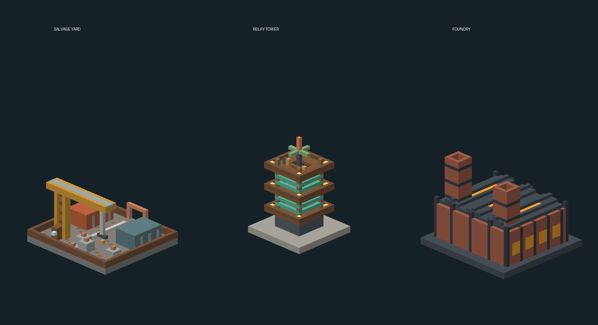

# Copperwake: Salvagers of the Rustwild

**Minecraft Java 1.21.1 · Fabric · Java 21 · 0.1.0-alpha.1**

The machines kept working after everyone left. Now their workshops are forests,
their freight yards are ruins, and their foreman still expects the next shift.
Enter the Rustwild, recover lost technology, and turn expeditions into new tools.

Copperwake is a separate mod with its own namespace, dimension, progression and
build. It does not depend on or modify Riftbound.



*Geometry rendered from the actual structure templates; not an in-game screenshot.*

## First expedition

1. Craft a **Field Journal** (three paper + copper ingot) and read it with right-click.
2. Craft a **Survey Key** using a compass, copper, redstone and an amethyst shard.
   Use it from the Overworld to enter the Rustwild. Bring ordinary survival gear.
3. Search three custom biomes: **Oxide Flats**, **Verdigris Woods**, and
   **Cinder Works**. Loot abandoned yards, climb relay towers, and enter foundries.
4. Defeat constructs and open guarded barrels for **Scrap**, **Memory Glass**,
   **Brass Gears**, and **Charged Cores**.
5. Build a **Salvage Bench**. Right-click to read your current contract;
   sneak-right-click to deliver the whole order. No partial orders are consumed.
6. Spend your rewards on gadgets and building materials. Four deliveries promote
   you to **Mechanist**; twelve unlock **Artificer** and let you use a Foreman Seal.
   Gadget and Seal recipes can be crafted before their required rank.
7. Use the Key again to return to your saved Overworld departure point. If you
   lose it, `/copperwake return` works from the Rustwild without an item.

Travel has a ten-second cooldown and searches for solid, nonhazardous landing
space without overwriting terrain. If no landing exists within the bounded search,
move in the Overworld before trying again. Normal death and inventory-drop rules
apply. New biome terrain and landmarks generate in the new dimension, including
when the mod is installed into an existing world. Back up an existing world before
installing this alpha or later removing a dimension mod.

## What is implemented

| System | First build |
| --- | --- |
| Exploration | Rustwild dimension; three custom land biomes; vanilla ocean between landmasses |
| Landmarks | 29×20×27 salvage yard with crane, 19×31×19 relay tower, 31×28×29 twin-stack foundry; climbable paths, loot barrels, and persistent guards |
| Enemies | Rust Mite with committed pounce; Coil Sentry with marked pulse; Foundry Foreman with boss bar and two combat phases |
| Guild | 14 authored contracts, three ranks, persisted per-player progress, deterministic order and repeatable late-game deliveries |
| Gadgets | Arc Gauntlet, handheld Spring Boots, Patch Kits, Survey Key and Foreman Seal |
| Building | Salvage Bench, Riveted Copper and luminous Lumen Glass |
| Guidance | Field Journal, status/contract commands, recipe-book unlocks and 12 progression advancements |

All three constructs have original animated voxel models. Item and block models
use original cuboid geometry with Minecraft's installed textures. Structures are
original builds generated from the versioned Python source; no third-party player
builds or mod code are bundled.

## Reward loop and combat

Memory Glass is exploration loot and cannot be made from guild rewards. Every
contract consumes it, so crafting cannot create an unlimited delivery loop.
Contracts connect Rustwild salvage with ordinary Minecraft exploration. Later
orders require ocean, Nether, ancient-city or nighttime materials. There are no
random daily resets or login rewards. The next order is fixed by your completed
count; late orders repeat after the final guild rank.

- **Arc Gauntlet:** Mechanist; one Scrap per discharge; up to five visible
  hostiles within six blocks; six base damage each; three-second cooldown.
- **Spring Boots:** a handheld launch device, not armor. Mechanist; one Scrap;
  grounded use only; four-second cooldown. Ordinary fall damage still applies.
- **Patch Kit:** consumed to restore four health points (two hearts); five-second
  cooldown; cannot be consumed at full health.
- **Foreman Seal:** Artificer; summon on clear Rustwild ground on a non-Peaceful
  difficulty. A nearby living Foreman prevents another summon. The seal is consumed
  only after a successful spawn. The boss persists; do not summon at your base.
- **Foreman Heart:** guaranteed boss trophy; can become a large batch of Lumen Glass.

Mites commit to their jump; sidestep the warning. Sentries lock their pulse on a
marked position; move before it fires. The Foreman marks a circular shockwave:
jump the impact, leave the circle, or use solid cover. Below half health it attacks
faster. Construct attacks do not explode blocks, place fire, or damage terrain.

## Commands

| Command | Purpose |
| --- | --- |
| `/copperwake` or `/copperwake journal` | Read the field guide |
| `/copperwake contract` | Show the order, inventory counts and reward |
| `/copperwake status` | Show rank and next promotion |
| `/copperwake return` | Return from the Rustwild without needing a Key |
| `/copperwake kit` | Operator-only exploration kit; does not grant guild rank |

Operators can also use vanilla `/locate structure copperwake:salvage_yard`,
`copperwake:relay_tower` or `copperwake:foundry` while in the Rustwild.

## Install and build

Install Fabric Loader **0.16.14 or later** for Minecraft **1.21.1**, Fabric API
**0.116.17+1.21.1**, and Java **21**. Both clients and servers need Copperwake and
Fabric API. The dedicated server never loads the client renderer entrypoint.

From this directory:

```sh
python tools/validate_resources.py
./gradlew build
```

On Windows use `gradlew.bat build`. The installable file is
`build/libs/copperwake-0.1.0-alpha.1.jar`; the `-sources.jar` is for developers.
The CI workflow uploads both as an artifact named `copperwake-fabric-1.21.1`.

`build` runs the pure domain harness and headless Minecraft GameTests.
`./gradlew domainTest` runs only progression checks; `./gradlew runGameTest`
runs the server integration checks. See [validation.md](docs/validation.md) for
the exact checks actually performed in this environment and remaining playtests.

## Development

- [Progression and economy](docs/progression.md)
- [World generation and structure sources](docs/worldgen.md)
- [Next development milestones](docs/roadmap.md)
- [Asset and dependency provenance](docs/provenance.md)

This is a functional alpha foundation, not a finished large content release.
Visual feel, exploration frequency, survival pacing and multiplayer balance need
human playtesting before a stable release.
